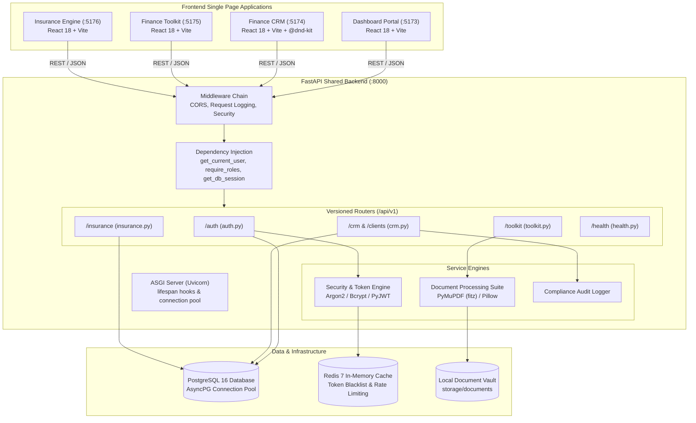
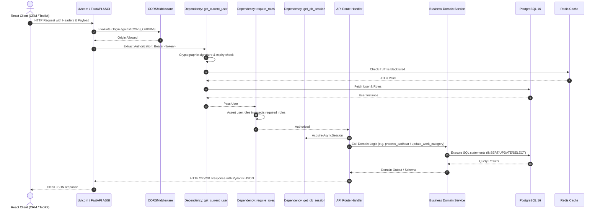
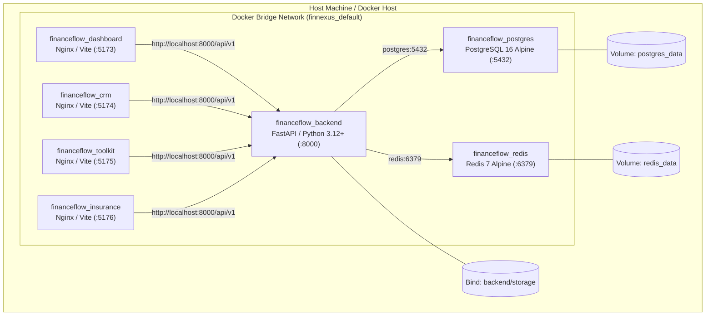

# 02 — FinNexus System Architecture & High-Level Design

## 1. High-Level System Architecture

FinNexus is designed as a **Micro-Frontend, Unified Backend Monorepo Architecture**. The platform isolates user-facing operational domains into four independent Single Page Applications (SPAs) while unifying identity, business logic, document manipulation, and data persistence behind a single asynchronous FastAPI backend.



---

## 2. Frontend Architecture

### 2.1 Technology & Tooling
Each of the four frontend applications is scaffolded with **Vite 5.4.21** and **React 18.3.1**, styled using **Tailwind CSS 3.4.10**, and routed using **React Router DOM 6.26.0**.
- **Dashboard (`dashboard/`)**: The main gateway and executive cockpit. Features high-level KPIs, activity summaries, recent work order tracking, and single sign-on redirect handling.
- **CRM (`crm/`)**: Complex relational workflows. Contains customer dossiers, financial profile editing, interactive checklist drag-and-drop pipelines (`@dnd-kit/core` & `@dnd-kit/sortable`), and supervisor override modals.
- **Toolkit (`toolkit/`)**: High-speed utility interface for financial document processing (Aadhaar & PAN card fixed auto-crop, PDF merging, image conversion) and loan/tax calculators.
- **Insurance Engine (`insurance-engine/`)**: Insurance catalog exploration, multi-factor quote calculation, policy lifecycle management, and claim filing.

### 2.2 Cross-Application Single Sign-On (SSO) & Navigation
The four SPAs run on distinct ports (`5173`, `5174`, `5175`, `5176`) during development and subdomains in production.
- **Shared Authentication Token**: When an operator logs in via the Dashboard or CRM, the returned JWT access token and refresh token are saved to browser `localStorage`.
- **Unified App Switcher**: Every SPA embeds the [`AppSwitcher`](file:///d:/project/crm/src/components/AppSwitcher.jsx) component in its top navigation bar, enabling seamless switching between Dashboard, CRM, Toolkit, and Insurance Engine without re-authenticating.
- **Design Tokens**: Standardized on a cohesive dark slate and teal palette (`slate-900`, `teal-600`, `emerald-500`, `rose-500`) with subtle backdrop glassmorphism (`backdrop-blur-xs`, `rounded-2xl`, `border-slate-200/90`).

---

## 3. Backend Architecture

### 3.1 FastAPI Application Factory & Lifespan Hooks
The backend is structured according to the FastAPI application factory pattern in [`backend/app/main.py`](file:///d:/project/backend/app/main.py):
```python
def create_application() -> FastAPI:
    application = FastAPI(
        title=settings.PROJECT_NAME,
        version=settings.VERSION,
        openapi_url=f"{settings.API_V1_PREFIX}/openapi.json",
        lifespan=lifespan,
    )
    application.add_middleware(CORSMiddleware, allow_origins=settings.CORS_ORIGINS, ...)
    application.include_router(api_router, prefix=settings.API_V1_PREFIX)
    return application
```
The `lifespan` async context manager gracefully initializes connection pools on startup and ensures database engines are cleanly disposed of (`await engine.dispose()`) on shutdown.

### 3.2 Dependency Injection Pattern
FastAPI's `Depends` system provides clean, testable separation of concerns:
- [`get_db_session`](file:///d:/project/backend/app/db/session.py): Yields an asynchronous SQLAlchemy session (`AsyncSession`) with automatic rollback on unhandled exceptions and explicit commit/flush management.
- [`get_current_user`](file:///d:/project/backend/app/core/dependencies.py): Decodes the Bearer JWT, validates token expiration, checks the Redis JTI blacklist, and resolves the active `User` entity with its assigned roles.
- [`require_roles(["ADMIN", "SUPER_ADMIN"])`](file:///d:/project/backend/app/core/dependencies.py#L65): Higher-order dependency enforcing strict Role-Based Access Control before reaching router handlers.

---

## 4. Database & ORM Architecture

### 4.1 Engine & Connection Pooling
- **Primary Async Driver**: `postgresql+asyncpg` for high-throughput, non-blocking I/O during request handling. Configured with connection pool size of 20 and max overflow of 10.
- **Synchronous Migration Driver**: `postgresql+psycopg` for Alembic schema migrations.
- **Test In-Memory Driver**: `sqlite+aiosqlite:///:memory:` for isolated, lightning-fast test suite execution without external database dependencies.

### 4.2 Alembic Migration History
Database schema changes are strictly version-controlled under `backend/alembic/versions/`:
1. `20261014_1633_fad623e5f3cb_initial_schema.py`: Core identity, roles, customers, financial profiles, customer notes, tasks, documents, audit logs.
2. `20261014_1840_6c0faee54a05_add_crm_work_order_module.py`: Work categories, work orders, checklist items, history, notifications.
3. `20261015_2030_7d1ebff65b16_add_client_archival_and_manager_role.py`: Client soft archival (`is_archived`, `archived_at`) and `MANAGER` role.
4. `20261016_0100_add_work_order_scheduling_and_reminders.py`: Multi-recipient work order reminders and scheduling fields.

---

## 5. Request Lifecycle Sequence



---

## 6. Deployment Architecture

The entire platform is containerized using Docker and Docker Compose ([`docker-compose.yml`](file:///d:/project/docker-compose.yml)):



---

## 7. Architectural Decisions & Constraints

1. **Monorepo Cohesion**: Preserves shared models, consistent naming, and unified git history without requiring npm registry publishing.
2. **Fixed Geometric Cropping**: Bypassed error-prone manual slider calibration in favor of millisecond C-level bounding box slicing via PyMuPDF.
3. **Stateless JWT with State-Backed Revocation**: Combines the horizontal scalability of JWTs with the instant revocation guarantees of Redis.
4. **Relational + JSON Hybrid Design**: Relational schemas for core transactions (work orders, customers) paired with JSON documents for dynamic checklist templates.
