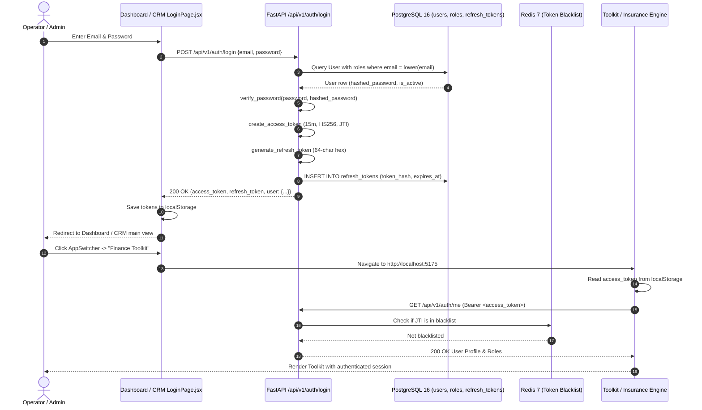
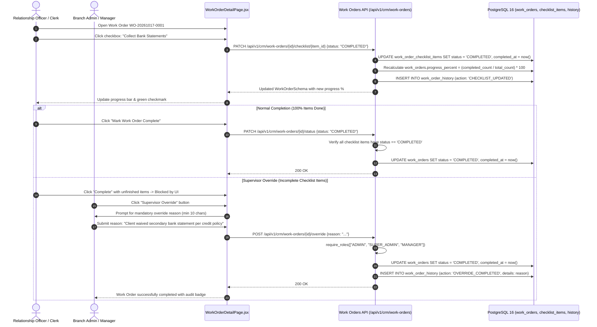
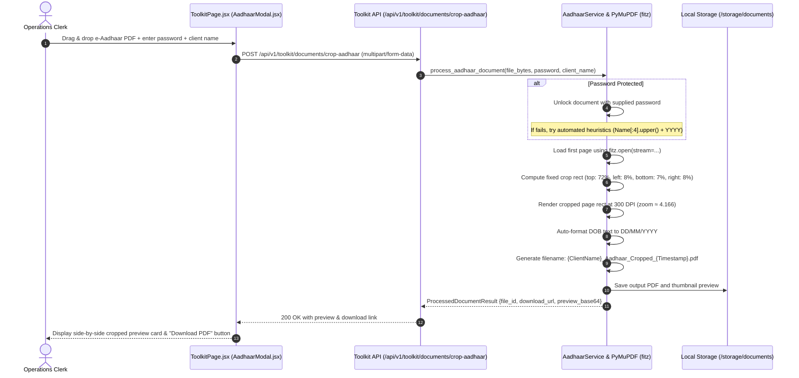

# 05 — FinNexus End-to-End Feature Flows

This document details the step-by-step technical workflows for the major capabilities in FinNexus, tracing requests from frontend user interactions down through API routers, security middleware, domain services, database transactions, and client updates.

---

## 1. Authentication & Cross-App Single Sign-On (SSO) Flow

### 1.1 Architecture & Mechanics
FinNexus uses a centralized authentication gateway hosted in the Dashboard and CRM applications. Authenticated tokens are stored in `localStorage` and shared across all four applications running on localhost or corporate subdomains.



---

## 2. Customer 360 Onboarding & Financial Profiling Flow

### 2.1 Workflow Steps
1. **Client Registration**: Operator navigates to **CRM → Clients → New Client**.
2. **PAN & Identity Verification**: Frontend enforces 10-character uppercase alphanumeric regex for Indian PAN numbers (`[A-Z]{5}[0-9]{4}[A-Z]{1}`).
3. **API Dispatch**: `POST /api/v1/crm/customers` transmits payload.
4. **Backend Constraint Validation**:
   - Checks uniqueness of `email` and `pan_number`.
   - Normalizes phone numbers to standard format.
5. **Transactional Creation**:
   - Inserts `Customer` record.
   - Inserts linked `FinancialProfile` record with monthly income, existing debt obligations, and initial CIBIL credit score (300–900).
   - Generates initial audit log entry in `audit_logs`.
6. **Response & Dossier Activation**: Returns `CustomerSchema`, displaying customer dossier with tabs for Financial Profile, Work Orders, Documents, Notes, and Tasks.

---

## 3. Work Category Drag-and-Drop Checklist Reordering Flow

### 3.1 Overview
Work Categories define default milestone templates cloned into new work orders. Administrators can reorder checklist steps vertically using drag handles with persistent sequential ordering.

```mermaid
sequenceDiagram
    autonumber
    actor Admin as Branch Admin / Super Admin
    participant UI as CategoriesPage.jsx (@dnd-kit)
    participant API as CRM API (/api/v1/crm/categories/{id})
    participant DB as PostgreSQL 16 (work_categories)

    Admin->>UI: Click "Edit Category Template"
    UI->>UI: Open modal, populate templateItems with stable step IDs
    
    Admin->>UI: Drag Step 3 up to Position 1 (GripVertical handle)
    UI->>UI: @dnd-kit sensor triggers handleDragEnd
    UI->>UI: arrayMove(templateItems, oldIndex, newIndex)
    UI->>UI: Reorder state immediately, re-index badges (1, 2, 3...)
    
    Admin->>UI: Click "Save Category"
    UI->>UI: Map templateItems with position = arrayIndex
    UI->>API: PUT /api/v1/crm/categories/{id} {checklist_template: [...]}
    API->>API: require_roles(["ADMIN", "SUPER_ADMIN"])
    API->>API: _normalize_checklist_template() cleans titles & sequential 0..N positions
    API->>DB: UPDATE work_categories SET checklist_template = :json_data
    DB-->>API: Success
    API-->>UI: 200 OK WorkCategorySchema (sorted by position)
    UI->>UI: Refresh category cards; drawer displays reordered pipeline
    UI-->>Admin: Show success toast; modal closes
```

---

## 4. Work Order Lifecycle & Checklist Execution Flow

### 4.1 State Machine & Quality Gates
Work orders progress through defined stages: `PENDING` $\rightarrow$ `IN_PROGRESS` $\rightarrow$ `REVIEW` $\rightarrow$ `COMPLETED` (or `BLOCKED` / `CANCELLED`).



---

## 5. Document Processing & Auto-Cropping Pipeline Flow

### 5.1 Aadhaar & PAN Card Processing
Operators process raw scans or password-locked e-KYC PDFs into standardized 300 DPI laminated card outputs.



---

## 6. Financial Planning Calculators Flow

### 6.1 Loan EMI Calculation
- **Trigger**: User inputs Principal amount ($P$), Annual Interest Rate ($R$), and Tenure in months ($N$) in **Toolkit → Loan EMI Calculator**.
- **Request**: `POST /api/v1/toolkit/calculator/emi`.
- **Backend Computation**:
  - Validates $P > 0$, $R \ge 0$, $N > 0$.
  - Executes amortized formula:
    $$EMI = \frac{P \cdot r \cdot (1 + r)^N}{(1 + r)^N - 1}$$
  - Generates full month-by-month table of opening balance, principal repayment, interest payment, and closing balance.
- **Response**: Returns summary metrics and complete tabular schedule for immediate on-screen analysis and CSV/PDF export.

---

## 7. Insurance Underwriting & Quoting Flow

### 7.1 Workflow Steps
1. **Catalog Exploration**: Operator navigates to **Insurance Engine → Products** (`GET /api/v1/insurance/products`) to browse Term Life, Comprehensive Health, Motor, or Commercial Property plans.
2. **Quote Configuration**: Operator selects product and inputs applicant details:
   - Age, gender, tobacco/smoking status, sum assured, policy tenure.
3. **Quotation Generation**: `POST /api/v1/insurance/quotes` executes underwriting risk multipliers (e.g. smoker surcharge, age bracket loading) and returns gross premium, applicable GST (18%), and net payable premium.
4. **Policy Origination**: Operator submits client KYC details to originate policy in `PENDING_REVIEW` state (`POST /api/v1/insurance/policies`).
5. **Claims Tracking**: Policyholders or agents can file cashless hospitalization or accidental claims (`POST /api/v1/insurance/claims`), tracking stage progression from `FILED` $\rightarrow$ `VETTING` $\rightarrow$ `APPROVED` $\rightarrow$ `SETTLED`.
