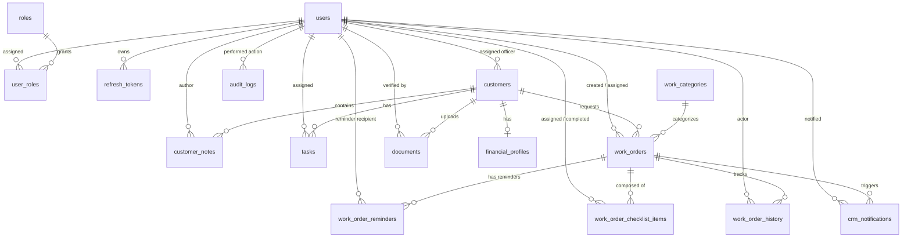

# 06 — FinNexus Database Design & Schema Reference

## 1. Database Architecture Overview

FinNexus uses **PostgreSQL 16** as its primary production relational database engine. In automated test environments, the platform dynamically leverages an isolated, in-memory **SQLite** engine (`sqlite+aiosqlite:///:memory:`) using dialect-variant column mappings (e.g. `JSONB().with_variant(JSON, "sqlite")`).

### Key Characteristics
- **Primary Keys**: Universally uses UUIDv4 (`Uuid` in SQLAlchemy, storing as native `uuid` in Postgres or 36-char string in SQLite).
- **Timezone-Aware Timestamps**: All temporal columns use `DateTime(timezone=True)` with UTC defaults (`lambda: datetime.now(UTC)`).
- **Foreign Key Constraints & Cascades**: Foreign keys strictly declare referential integrity behaviors:
  - `CASCADE`: Deleting a Customer purges linked notes, financial profile, tasks, and documents.
  - `SET NULL`: Deactivating or deleting staff users preserves client histories by setting `assigned_officer_id = NULL`.
  - `RESTRICT`: Work categories cannot be deleted if referenced by existing work orders.

---

## 2. Entity Relationship Diagram (ERD)

---

## 3. Database Table Definitions

### 3.1 `users`
Staff account identity records.
| Column | Type | Constraints | Description |
|---|---|---|---|
| `id` | `UUID` | `PRIMARY KEY`, Default: `uuid.uuid4` | Unique staff identifier. |
| `email` | `VARCHAR(255)` | `UNIQUE`, `NOT NULL`, Indexed | Normalized staff login email. |
| `hashed_password` | `VARCHAR(255)` | `NOT NULL` | Argon2id or Bcrypt cryptographic hash. |
| `full_name` | `VARCHAR(150)` | `NOT NULL` | Display name of staff member. |
| `is_active` | `BOOLEAN` | `NOT NULL`, Default: `TRUE`, Indexed | Active status flag. |
| `created_at` | `TIMESTAMPTZ` | `NOT NULL`, Default: `UTC NOW` | Account creation timestamp. |
| `updated_at` | `TIMESTAMPTZ` | `NOT NULL`, Default: `UTC NOW` | Last update timestamp. |

### 3.2 `roles`
System authorization capabilities.
| Column | Type | Constraints | Description |
|---|---|---|---|
| `id` | `UUID` | `PRIMARY KEY`, Default: `uuid.uuid4` | Role ID. |
| `name` | `VARCHAR(50)` | `UNIQUE`, `NOT NULL` | Role identifier (`SUPER_ADMIN`, `ADMIN`, `MANAGER`, `LOAN_OFFICER`, etc.). |
| `description` | `VARCHAR(255)` | `NULLABLE` | Human-readable role description. |

### 3.3 `user_roles`
Many-to-many junction table between users and roles.
| Column | Type | Constraints | Description |
|---|---|---|---|
| `user_id` | `UUID` | `PRIMARY KEY`, `FK -> users.id (ON DELETE CASCADE)` | User ID. |
| `role_id` | `UUID` | `PRIMARY KEY`, `FK -> roles.id (ON DELETE CASCADE)` | Role ID. |

### 3.4 `refresh_tokens`
Long-lived session hash tracking for token rotation.
| Column | Type | Constraints | Description |
|---|---|---|---|
| `id` | `UUID` | `PRIMARY KEY`, Default: `uuid.uuid4` | Token record ID. |
| `user_id` | `UUID` | `NOT NULL`, `FK -> users.id (ON DELETE CASCADE)`, Indexed | User ID. |
| `token_hash` | `VARCHAR(64)` | `UNIQUE`, `NOT NULL`, Indexed | SHA-256 hash of the 64-char refresh token. |
| `expires_at` | `TIMESTAMPTZ` | `NOT NULL` | Token expiration timestamp (7 days). |
| `revoked_at` | `TIMESTAMPTZ` | `NULLABLE` | Timestamp when revoked/rotated. |

### 3.5 `customers`
Customer 360 leads and client profiles.
| Column | Type | Constraints | Description |
|---|---|---|---|
| `id` | `UUID` | `PRIMARY KEY`, Default: `uuid.uuid4` | Customer ID. |
| `first_name` | `VARCHAR(100)` | `NOT NULL` | Customer first name. |
| `last_name` | `VARCHAR(100)` | `NOT NULL` | Customer last name. |
| `email` | `VARCHAR(255)` | `UNIQUE`, `NOT NULL`, Indexed | Customer email address. |
| `phone` | `VARCHAR(20)` | `NOT NULL` | Contact telephone number. |
| `pan_number` | `VARCHAR(10)` | `UNIQUE`, `NOT NULL`, Indexed | Indian Permanent Account Number (10 chars). |
| `pipeline_status`| `VARCHAR(40)` | `NOT NULL`, Default: `'NEW_LEAD'`, Indexed | Stage: `NEW_LEAD`, `CONTACTED`, `DOCUMENTS_PENDING`, `UNDERWRITING`, `APPROVED`, `DISBURSED`, `REJECTED`. |
| `reference_source`| `VARCHAR(100)`| `NULLABLE` | Acquisition channel (e.g. `Direct`, `Partner`). |
| `is_archived` | `BOOLEAN` | `NOT NULL`, Default: `FALSE`, Indexed | Soft archival status flag. |
| `archived_at` | `TIMESTAMPTZ` | `NULLABLE` | Timestamp when archived. |
| `created_by_id` | `UUID` | `NULLABLE`, `FK -> users.id (ON DELETE SET NULL)` | Staff creator. |
| `assigned_officer_id`| `UUID` | `NULLABLE`, `FK -> users.id (ON DELETE SET NULL)`, Indexed | Assigned relationship officer. |
| `created_at` | `TIMESTAMPTZ` | `NOT NULL`, Default: `UTC NOW` | Record creation timestamp. |
| `updated_at` | `TIMESTAMPTZ` | `NOT NULL`, Default: `UTC NOW` | Last modification timestamp. |

### 3.6 `financial_profiles`
Customer financial obligations and risk parameters.
| Column | Type | Constraints | Description |
|---|---|---|---|
| `id` | `UUID` | `PRIMARY KEY`, Default: `uuid.uuid4` | Profile ID. |
| `customer_id` | `UUID` | `UNIQUE`, `NOT NULL`, `FK -> customers.id (ON DELETE CASCADE)` | 1-to-1 link to customer. |
| `employment_type`| `VARCHAR(50)` | `NOT NULL` | `SALARIED`, `SELF_EMPLOYED`, `BUSINESS`, `RETIRED`. |
| `monthly_income`| `NUMERIC(14,2)`| `NOT NULL`, `CHECK (monthly_income >= 0)` | Verified monthly net income. |
| `monthly_obligations`| `NUMERIC(14,2)`| `NOT NULL`, Default: `0.00`, `CHECK (monthly_obligations >= 0)` | Existing debt payments. |
| `cibil_score` | `INTEGER` | `NULLABLE`, `CHECK (cibil_score IS NULL OR (cibil_score >= 300 AND cibil_score <= 900))` | Bureau credit rating. |
| `risk_tier` | `VARCHAR(20)` | `NOT NULL`, Default: `'MEDIUM'` | `LOW`, `MEDIUM`, `HIGH`, `CRITICAL`. |
| `updated_at` | `TIMESTAMPTZ` | `NOT NULL`, Default: `UTC NOW` | Last assessment timestamp. |

### 3.7 `customer_notes`
Interaction records and audit comments.
| Column | Type | Constraints | Description |
|---|---|---|---|
| `id` | `UUID` | `PRIMARY KEY`, Default: `uuid.uuid4` | Note ID. |
| `customer_id` | `UUID` | `NOT NULL`, `FK -> customers.id (ON DELETE CASCADE)`, Indexed | Associated customer. |
| `author_id` | `UUID` | `NOT NULL`, `FK -> users.id (ON DELETE RESTRICT)` | Staff author. |
| `content` | `TEXT` | `NOT NULL` | Narrative text. |
| `created_at` | `TIMESTAMPTZ` | `NOT NULL`, Default: `UTC NOW` | Note creation timestamp. |

### 3.8 `tasks`
SLA-tracked actionable tasks.
| Column | Type | Constraints | Description |
|---|---|---|---|
| `id` | `UUID` | `PRIMARY KEY`, Default: `uuid.uuid4` | Task ID. |
| `customer_id` | `UUID` | `NOT NULL`, `FK -> customers.id (ON DELETE CASCADE)` | Associated customer. |
| `assigned_to_id`| `UUID` | `NOT NULL`, `FK -> users.id (ON DELETE RESTRICT)`, Indexed | Staff assignee. |
| `title` | `VARCHAR(200)`| `NOT NULL` | Action summary. |
| `description` | `TEXT` | `NULLABLE` | Detailed instructions. |
| `priority` | `VARCHAR(20)` | `NOT NULL`, Default: `'MEDIUM'` | `LOW`, `MEDIUM`, `HIGH`, `URGENT`. |
| `status` | `VARCHAR(30)` | `NOT NULL`, Default: `'PENDING'`, Indexed | `PENDING`, `IN_PROGRESS`, `COMPLETED`, `CANCELLED`. |
| `due_date` | `DATE` | `NOT NULL`, Indexed | SLA deadline date. |
| `completed_at` | `TIMESTAMPTZ` | `NULLABLE` | Completion timestamp. |
| `created_at` | `TIMESTAMPTZ` | `NOT NULL`, Default: `UTC NOW` | Creation timestamp. |

### 3.9 `work_categories`
Preset operational categories with default checklist templates.
| Column | Type | Constraints | Description |
|---|---|---|---|
| `id` | `UUID` | `PRIMARY KEY`, Default: `uuid.uuid4` | Category ID. |
| `name` | `VARCHAR(100)`| `UNIQUE`, `NOT NULL`, Indexed | Category name (e.g. `Work: MFU`). |
| `code` | `VARCHAR(50)` | `UNIQUE`, `NOT NULL`, Indexed | System code (e.g. `WORK_MFU`). |
| `description` | `TEXT` | `NULLABLE` | Operational scope. |
| `default_priority`| `VARCHAR(20)`| `NOT NULL`, Default: `'NORMAL'` | Default priority level. |
| `checklist_template`| `JSON` | `NULLABLE` | JSON array of checklist step objects with normalized `position` integers. |
| `is_active` | `BOOLEAN` | `NOT NULL`, Default: `TRUE` | Available for new work orders. |
| `created_at` | `TIMESTAMPTZ` | `NOT NULL`, Default: `UTC NOW` | Creation timestamp. |

### 3.10 `work_orders`
Multi-stage operational client service delivery orders.
| Column | Type | Constraints | Description |
|---|---|---|---|
| `id` | `UUID` | `PRIMARY KEY`, Default: `uuid.uuid4` | Work order ID. |
| `order_number` | `VARCHAR(50)` | `UNIQUE`, `NOT NULL`, Indexed | Formatted tracking code (`WO-YYYYMMDD-XXXX`). |
| `title` | `VARCHAR(200)`| `NOT NULL` | Order title. |
| `description` | `TEXT` | `NULLABLE` | Detailed narrative. |
| `client_id` | `UUID` | `NOT NULL`, `FK -> customers.id (ON DELETE CASCADE)`, Indexed | Beneficiary client. |
| `category_id` | `UUID` | `NOT NULL`, `FK -> work_categories.id (ON DELETE RESTRICT)`, Indexed | Work category. |
| `created_by_id` | `UUID` | `NOT NULL`, `FK -> users.id (ON DELETE RESTRICT)`, Indexed | Creator staff ID. |
| `assigned_to_id`| `UUID` | `NULLABLE`, `FK -> users.id (ON DELETE SET NULL)`, Indexed | Assignee staff ID. |
| `priority` | `VARCHAR(20)` | `NOT NULL`, Default: `'NORMAL'`, Indexed | `LOW`, `NORMAL`, `HIGH`, `URGENT`. |
| `status` | `VARCHAR(30)` | `NOT NULL`, Default: `'PENDING'`, Indexed | `PENDING`, `IN_PROGRESS`, `REVIEW`, `COMPLETED`, `CANCELLED`, `BLOCKED`. |
| `due_date` | `TIMESTAMPTZ` | `NOT NULL`, Indexed | Delivery deadline. |
| `completed_at` | `TIMESTAMPTZ` | `NULLABLE` | Final completion timestamp. |
| `progress_percent`| `INTEGER` | `NOT NULL`, Default: `0` | Calculated completion percentage (0–100). |
| `priority_notes`| `TEXT` | `NULLABLE` | Priority justification. |
| `work_priority` | `VARCHAR(50)` | `NULLABLE` | Secondary priority tag. |
| `custom_priority`| `VARCHAR(150)`| `NULLABLE` | Custom label. |
| `created_at` | `TIMESTAMPTZ` | `NOT NULL`, Default: `UTC NOW` | Order creation timestamp. |
| `updated_at` | `TIMESTAMPTZ` | `NOT NULL`, Default: `UTC NOW` | Order update timestamp. |

### 3.11 `work_order_checklist_items`
Granular milestone tasks within a work order.
| Column | Type | Constraints | Description |
|---|---|---|---|
| `id` | `UUID` | `PRIMARY KEY`, Default: `uuid.uuid4` | Checklist item ID. |
| `work_order_id`| `UUID` | `NOT NULL`, `FK -> work_orders.id (ON DELETE CASCADE)`, Indexed | Parent work order. |
| `title` | `VARCHAR(255)`| `NOT NULL` | Task title. |
| `description` | `TEXT` | `NULLABLE` | Task instruction. |
| `assigned_to_id`| `UUID` | `NULLABLE`, `FK -> users.id (ON DELETE SET NULL)` | Individual step assignee. |
| `status` | `VARCHAR(30)` | `NOT NULL`, Default: `'PENDING'`, Indexed | `PENDING`, `IN_PROGRESS`, `BLOCKED`, `COMPLETED`. |
| `position` | `INTEGER` | `NOT NULL`, Default: `0` | Sort sequence index. |
| `due_date` | `TIMESTAMPTZ` | `NULLABLE` | Step SLA deadline. |
| `completed_at` | `TIMESTAMPTZ` | `NULLABLE` | Completion timestamp. |
| `completed_by_id`| `UUID` | `NULLABLE`, `FK -> users.id (ON DELETE SET NULL)` | Staff member who completed step. |
| `notes` | `TEXT` | `NULLABLE` | Completion comment. |
| `created_at` | `TIMESTAMPTZ` | `NOT NULL`, Default: `UTC NOW` | Creation timestamp. |

### 3.12 `work_order_reminders`
Reminder distribution list for upcoming work order deadlines.
| Column | Type | Constraints | Description |
|---|---|---|---|
| `work_order_id`| `UUID` | `PRIMARY KEY`, `FK -> work_orders.id (ON DELETE CASCADE)` | Work order ID. |
| `user_id` | `UUID` | `PRIMARY KEY`, `FK -> users.id (ON DELETE CASCADE)` | Recipient user ID. |
| `created_at` | `TIMESTAMPTZ` | `NOT NULL`, Default: `UTC NOW` | Timestamp added. |

### 3.13 `work_order_history`
Append-only immutable audit trail for work order transitions.
| Column | Type | Constraints | Description |
|---|---|---|---|
| `id` | `UUID` | `PRIMARY KEY`, Default: `uuid.uuid4` | History event ID. |
| `work_order_id`| `UUID` | `NOT NULL`, `FK -> work_orders.id (ON DELETE CASCADE)`, Indexed | Associated work order. |
| `actor_id` | `UUID` | `NOT NULL`, `FK -> users.id (ON DELETE RESTRICT)` | Staff member performing change. |
| `action` | `VARCHAR(50)` | `NOT NULL` | Action code (`CREATED`, `STATUS_CHANGED`, `CHECKLIST_UPDATED`, `OVERRIDE_COMPLETED`, etc.). |
| `details` | `TEXT` | `NULLABLE` | State change description or override reason. |
| `timestamp` | `TIMESTAMPTZ` | `NOT NULL`, Default: `UTC NOW`, Indexed | Timestamp of event. |

### 3.14 `crm_notifications`
In-app notifications for task assignments and deadline alerts.
| Column | Type | Constraints | Description |
|---|---|---|---|
| `id` | `UUID` | `PRIMARY KEY`, Default: `uuid.uuid4` | Notification ID. |
| `user_id` | `UUID` | `NOT NULL`, `FK -> users.id (ON DELETE CASCADE)`, Indexed | Recipient user. |
| `work_order_id`| `UUID` | `NULLABLE`, `FK -> work_orders.id (ON DELETE SET NULL)` | Optional linked work order. |
| `title` | `VARCHAR(200)`| `NOT NULL` | Short title. |
| `message` | `TEXT` | `NOT NULL` | Notification narrative. |
| `is_read` | `BOOLEAN` | `NOT NULL`, Default: `FALSE`, Indexed | Read status. |
| `notification_type`| `VARCHAR(50)`| `NOT NULL`, Default: `'TASK_ASSIGNED'` | Type classification. |
| `created_at` | `TIMESTAMPTZ` | `NOT NULL`, Default: `UTC NOW`, Indexed | Dispatched timestamp. |

### 3.15 `documents`
Secure customer file vault metadata and verification states.
| Column | Type | Constraints | Description |
|---|---|---|---|
| `id` | `UUID` | `PRIMARY KEY`, Default: `uuid.uuid4` | Document ID. |
| `customer_id` | `UUID` | `NOT NULL`, `FK -> customers.id (ON DELETE CASCADE)`, Indexed | Linked customer. |
| `document_type`| `VARCHAR(50)` | `NOT NULL` | `AADHAAR`, `PAN`, `BANK_STATEMENT`, `SALARY_SLIP`, `ITR`, `OTHER`. |
| `original_filename`| `VARCHAR(255)`| `NOT NULL` | Original uploaded file name. |
| `storage_path` | `VARCHAR(500)`| `UNIQUE`, `NOT NULL` | Storage path on filesystem or object store. |
| `file_size_bytes`| `INTEGER` | `NOT NULL`, `CHECK (file_size_bytes > 0)` | File size in bytes. |
| `mime_type` | `VARCHAR(100)`| `NOT NULL` | MIME type (`application/pdf`, `image/png`, etc.). |
| `sha256_hash` | `VARCHAR(64)` | `NOT NULL`, Indexed | Cryptographic checksum for integrity. |
| `verification_status`| `VARCHAR(30)`| `NOT NULL`, Default: `'PENDING_REVIEW'`, Indexed | `PENDING_REVIEW`, `VERIFIED`, `REJECTED`. |
| `verified_by_id`| `UUID` | `NULLABLE`, `FK -> users.id (ON DELETE SET NULL)` | Verifier staff ID. |
| `rejection_reason`| `TEXT` | `NULLABLE` | Reason if rejected. |
| `created_at` | `TIMESTAMPTZ` | `NOT NULL`, Default: `UTC NOW` | Upload timestamp. |

### 3.16 `audit_logs`
System-wide immutable compliance audit log.
| Column | Type | Constraints | Description |
|---|---|---|---|
| `id` | `UUID` | `PRIMARY KEY`, Default: `uuid.uuid4` | Audit record ID. |
| `actor_id` | `UUID` | `NULLABLE`, `FK -> users.id (ON DELETE SET NULL)`, Indexed | User initiating action. |
| `action` | `VARCHAR(50)` | `NOT NULL` | Action code (`CREATE`, `UPDATE`, `DELETE`, `LOGIN`, `OVERRIDE`). |
| `resource_type`| `VARCHAR(50)` | `NOT NULL` | Target entity (`Customer`, `WorkOrder`, `User`). |
| `resource_id` | `UUID` | `NULLABLE` | Identifier of affected entity. |
| `state_delta` | `JSONB / JSON`| `NULLABLE` | Before/after state snapshot. |
| `ip_address` | `VARCHAR(45)` | `NULLABLE` | Client IPv4 / IPv6 address. |
| `created_at` | `TIMESTAMPTZ` | `NOT NULL`, Default: `UTC NOW`, Indexed | Audit entry timestamp. |
