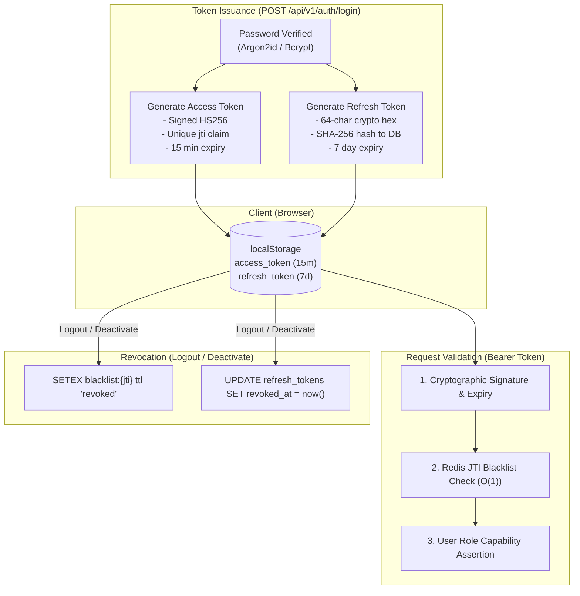

# 08 — FinNexus Authentication, RBAC & Security Architecture

## 1. Authentication Architecture

FinNexus implements a hardened **Dual-Token State-Backed Stateless Architecture**:



### 1.1 Password Storage & Complexity
- **Algorithm**: Argon2id via `argon2-cffi` with transparent fallback to Bcrypt (`bcrypt.gensalt(12)`).
- **Complexity Enforcement**: Validated by `validate_password_complexity` in [`backend/app/core/security.py`](file:///d:/project/backend/app/core/security.py#L22):
  - Minimum length: 8 characters.
  - At least 1 uppercase letter (`A-Z`).
  - At least 1 lowercase letter (`a-z`).
  - At least 1 numeric digit (`0-9`).
  - At least 1 special character (`!@#$%^&*()_+-=[]{}|;:,.<>?`).

### 1.2 Access Token (JWT) Specifications
- Signed using HMAC-SHA256 with `settings.SECRET_KEY`.
- Claims payload:
  - `sub`: Stringified user UUID.
  - `email`: User login email.
  - `roles`: Array of string role names (e.g. `["ADMIN", "SUPER_ADMIN"]`).
  - `full_name`: User display name.
  - `jti`: Unique random UUID preventing token replay.
  - `iat`: Epoch timestamp issued.
  - `exp`: Epoch timestamp expired (`iat + 900 seconds`).

### 1.3 Refresh Token Security & Rotation
- Stored on client as a 64-character random hex string (`secrets.token_hex(32)`).
- **Stored on Server only as SHA-256 Hash**: [`refresh_tokens.token_hash`](file:///d:/project/backend/app/db/models/auth.py#L140). Even a complete database dump will not expose valid refresh tokens.
- **Strict Single-Use Rotation**: Calling `POST /api/v1/auth/refresh` immediately sets `revoked_at = now()` on the old token and issues a completely fresh token pair.

---

## 2. Role-Based Access Control (RBAC) Matrix

FinNexus enforces hierarchical and functional role boundaries:

| Resource / Endpoint | `SUPER_ADMIN` | `ADMIN` | `MANAGER` | `LOAN_OFFICER` | `UNDERWRITER` | `AUDITOR` | `EMPLOYEE` |
|---|:---:|:---:|:---:|:---:|:---:|:---:|:---:|
| **Dynamic Staff Provisioning** (`POST /auth/register`) | ✅ | ✅ | ❌ | ❌ | ❌ | ❌ | ❌ |
| **User Deactivation / Role Edit** (`PATCH /auth/users/{id}`) | ✅ | ✅ | ❌ | ❌ | ❌ | ❌ | ❌ |
| **Demo Data Purge** (`POST /api/v1/cleanup/demo-data`) | ✅ | ❌ | ❌ | ❌ | ❌ | ❌ | ❌ |
| **Work Category & Template Drag-Drop Edit** | ✅ | ✅ | ❌ | ❌ | ❌ | ❌ | ❌ |
| **Work Order Creation** (`POST /crm/work-orders`) | ✅ | ✅ | ✅ | ✅ | ❌ | ❌ | ✅ |
| **Work Order Deletion** (`DELETE /crm/work-orders/{id}`) | ✅ | ✅ | ❌ | ❌ | ❌ | ❌ | ❌ |
| **Work Order Reassignment** | ✅ | ✅ | ✅ | ❌ | ❌ | ❌ | ❌ |
| **Supervisor Completion Override** | ✅ | ✅ | ✅ | ❌ | ❌ | ❌ | ❌ |
| **Checklist Item Completion** | ✅ | ✅ | ✅ | ✅ | ✅ | ❌ | ✅ (Assigned only) |
| **View Restricted Work Orders** | ✅ | ✅ | ✅ | Own Dept | Own Dept | All (Audit) | Assigned Only |
| **Customer Dossier Creation & Editing** | ✅ | ✅ | ✅ | ✅ | ❌ | ❌ | ❌ |
| **Financial Profile & CIBIL Modification** | ✅ | ✅ | ❌ | ❌ | ✅ | ❌ | ❌ |
| **System-wide Audit Trail** (`GET /crm/history`) | ✅ | ✅ | ✅ | ❌ | ❌ | ✅ | ❌ |
| **Toolkit Document Cropping & Merge** | ✅ | ✅ | ✅ | ✅ | ✅ | ✅ | ✅ |

---

## 3. Enforcement Locations & Safety Protections

### 3.1 Backend Role Barrier Enforcement
Permissions are strictly enforced at the FastAPI dependency layer, not merely by hiding frontend UI buttons:
```python
@router.post("/categories", response_model=WorkCategorySchema)
async def create_work_category(
    payload: WorkCategoryCreate,
    current_user: User = Depends(require_roles(["ADMIN", "SUPER_ADMIN"])),
    session: AsyncSession = Depends(get_db_session),
):
    ...
```
Unauthorized requests receive an immediate `HTTP 403 Forbidden` response without touching database logic.

### 3.2 Last Super Admin Protection
To prevent accidental administrative lockout:
- [`backend/app/api/auth.py`](file:///d:/project/backend/app/api/auth.py#L445) verifies whether a user being deactivated or having their `SUPER_ADMIN` role revoked is the last active Super Admin.
- If only one active Super Admin exists, the operation is blocked with:
  ```json
  {
    "detail": "Cannot deactivate or demote the last active Super Admin account."
  }
  ```

### 3.3 Employee Resource Isolation
- In `GET /api/v1/crm/work-orders`, if the requesting user possesses only the `EMPLOYEE` role, the query automatically appends a filter:
  ```python
  stmt = stmt.where(WorkOrder.assigned_to_id == current_user.id)
  ```
  Employees cannot inspect other staff members' orders or confidential financial profiles.

---

## 4. Platform Security Controls

### 4.1 SQL Injection Prevention
- All database queries are constructed using **SQLAlchemy 2.0 select/insert/update expressions** with parameterized bind variables.
- Direct raw string SQL formatting (`f"SELECT ... {input}"`) is strictly prohibited.

### 4.2 Cross-Origin Resource Sharing (CORS)
- Configured in [`backend/app/main.py`](file:///d:/project/backend/app/main.py#L42) using `CORSMiddleware`.
- Allow origins is driven by the environment configuration `CORS_ORIGINS`:
  `["http://localhost:5173", "http://localhost:5174", "http://localhost:5175", "http://localhost:5176"]`.
- Wildcard `allow_origins=["*"]` is never used when `allow_credentials=True`.

### 4.3 Document Upload Safety
- Files uploaded to the Toolkit or CRM Document Vault undergo strict validation:
  - Binary header inspection (e.g. `%PDF-` magic bytes).
  - Maximum file size boundary (default 25 MB).
  - SHA-256 cryptographic hash calculated upon upload to detect tampering or duplicates.
  - Safe sanitized storage paths avoiding directory traversal attacks (`../`).

---

## 5. Automated Security Test Verification

The 15 security and RBAC scenarios are continuously validated by [`backend/tests/test_crm_rbac.py`](file:///d:/project/backend/tests/test_crm_rbac.py):

| Scenario | Tested Constraint | Verified Result |
|---|---|:---:|
| 1 | Unauthenticated calls to protected routes receive 401 | **PASSED** |
| 2 | Super Admin has global management authority | **PASSED** |
| 3 | Admin can perform branch management | **PASSED** |
| 4 | Employee can create permitted work orders | **PASSED** |
| 5 | Employee cannot edit work orders after creation (403) | **PASSED** |
| 6 | Employee cannot delete or archive work orders (403) | **PASSED** |
| 7 | Employee cannot reassign work orders (403) | **PASSED** |
| 8 | Employee can update assigned checklist items | **PASSED** |
| 9 | Employee cannot access another employee's restricted order (403) | **PASSED** |
| 10 | Employee cannot change roles or create admin accounts (403) | **PASSED** |
| 11 | Unauthorized completion override is rejected (403) | **PASSED** |
| 12 | Supervisor override requires reason & logs audit trail | **PASSED** |
| 13 | Unauthorized audit history access is blocked (403) | **PASSED** |
| 14 | Attempts to modify protected attributes are rejected | **PASSED** |
| 15 | Token tampering and revoked JTI rejected immediately | **PASSED** |
