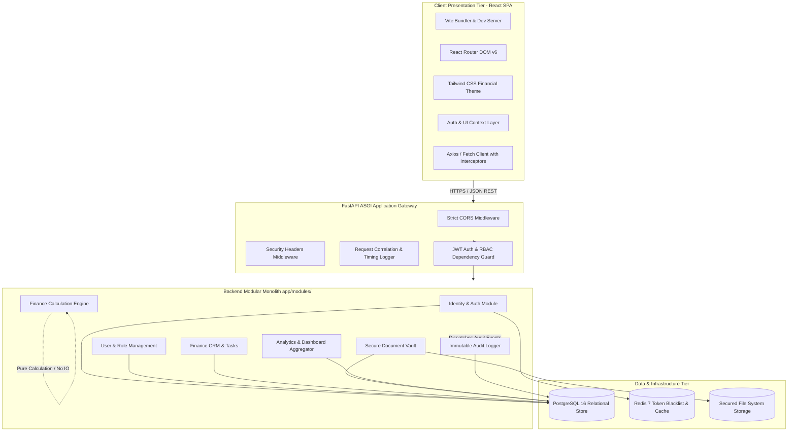

# System Architecture — FinanceFlow

**Document Version:** 1.0.0  
**Phase:** Phase 0 — Project Initialization  
**Status:** Approved Baseline  

---

## 1. Architectural Strategy: The Modular Monolith

FinanceFlow is architected as a **Modular Monolith**. This paradigm combines the operational simplicity, transactional consistency, and developer velocity of a single unified deployment with the strict domain boundaries and encapsulation typical of microservices.



---

## 2. Tier Boundaries & Responsibilities

### 2.1 Client Presentation Tier (Frontend)
- **Role:** Deliver a fast, responsive, and visually clear user experience for finance operators.
- **Tech Stack:** React 18+, JavaScript (strictly ES modules, no TypeScript), Vite, React Router v6, Tailwind CSS.
- **Core Principles:**
  - Zero raw business invariants or sensitive validation rules trusted solely on the client.
  - Centralized API communication with automatic request token injection and 401 refresh/redirect interceptors.
  - Clean separation between presentation components, stateful container pages, and service APIs.

### 2.2 Application Service Tier (Backend)
- **Role:** Single source of truth for business rules, calculations, data validation, and security enforcement.
- **Tech Stack:** Python 3.11+ / 3.14, FastAPI, Pydantic v2, SQLAlchemy 2.0 (Modern Declarative Mapping).
- **Core Principles:**
  - Controller-Service-Repository separation inside each module.
  - Pydantic models strictly validate all incoming payloads before reaching business logic.
  - SQLAlchemy 2.0 session lifecycle managed via FastAPI dependency injection (`yield session`), ensuring atomic transaction rollbacks on uncaught exceptions.

### 2.3 Data & Infrastructure Tier
- **PostgreSQL 16:** ACID-compliant relational persistence for customer records, users, audit trails, and document metadata.
- **Redis 7:** Ultra-low-latency in-memory store for revoked JWT token blacklists and active session tokens.
- **Secured Local / Volume File Storage:** Document files stored on dedicated volume mounts with non-guessable UUID filenames, verified via SHA-256 hashes.

---

## 3. Detailed Directory Structures

### 3.1 Backend Application Layout (`backend/`)

The backend codebase cleanly separates foundational infrastructure from modular domain plugins:

```
backend/
├── app/
│   ├── core/                      # Foundational configuration & core clients
│   │   ├── __init__.py
│   │   ├── config.py              # Pydantic Settings loading from .env (IMPLEMENTED)
│   │   └── redis.py               # Redis client pool & async health ping probe (IMPLEMENTED)
│   ├── db/                        # Database connectivity & session lifecycle
│   │   ├── __init__.py
│   │   └── session.py             # SQLAlchemy 2.x engine, async_sessionmaker & DB health probe (IMPLEMENTED)
│   ├── api/                       # API router consolidation & diagnostic endpoints
│   │   ├── __init__.py
│   │   ├── router.py              # Main /api/v1 router aggregating modules (IMPLEMENTED)
│   │   └── health.py              # Liveness, Readiness, and Health probes (IMPLEMENTED)
│   ├── modules/                   # Domain business modules (Scheduled Phases 3–7)
│   │   ├── identity/              # Authentication & Token lifecycle (Phase 3)
│   │   ├── users/                 # Staff profiles & RBAC (Phase 3)
│   │   ├── crm/                   # Customer profiles, notes, tasks (Phase 5)
│   │   ├── finance/               # Financial Calculation Toolkit (Phase 4)
│   │   ├── documents/             # Secure Document Management (Phase 6)
│   │   ├── analytics/             # Reporting & Dashboard metrics (Phase 7)
│   │   └── audit/                 # Tamper-evident Audit Logging (Phase 7)
│   └── main.py                    # FastAPI application factory & root endpoint (IMPLEMENTED)
├── tests/                         # Backend automated test suite (IMPLEMENTED)
│   ├── conftest.py                # Pytest async_client fixtures with ASGITransport (IMPLEMENTED)
│   └── test_health.py             # Tests for root, liveness, readiness, health & CORS (IMPLEMENTED)
├── alembic/                       # Migration scripts
│   ├── env.py                     # Alembic migration environment configured to Base.metadata (IMPLEMENTED)
│   ├── script.py.mako             # Async/sync migration script template (IMPLEMENTED)
│   └── versions/                  # Individual timestamped migrations (Phase 2+)
├── alembic.ini                    # Alembic configuration file (IMPLEMENTED)
├── pyproject.toml                 # Ruff linter and formatter configuration (IMPLEMENTED)
├── pytest.ini                     # Pytest runner configuration (IMPLEMENTED)
├── requirements.txt               # Pinned Python package dependencies (IMPLEMENTED)
├── .env.example                   # Environment configuration template (IMPLEMENTED)
└── Dockerfile.backend             # Production & dev container definition (IMPLEMENTED)
```

### 3.2 Frontend Application Layout (`frontend/`)

```
frontend/
├── public/                        # Static brand assets
├── src/
│   ├── components/                # Reusable UI component library (Phase 1–8)
│   ├── layouts/
│   │   └── AppLayout.jsx          # SaaS shell with responsive sidebar & status pill (IMPLEMENTED)
│   ├── pages/
│   │   ├── WorkspacePage.jsx      # Live diagnostics & modular architecture preview (IMPLEMENTED)
│   │   ├── CustomersPlaceholder.jsx # Phase 5 CRM placeholder (IMPLEMENTED)
│   │   ├── DocumentsPlaceholder.jsx # Phase 6 Document Vault placeholder (IMPLEMENTED)
│   │   └── CalculatorPlaceholder.jsx# Phase 4 Finance Toolkit placeholder (IMPLEMENTED)
│   ├── services/
│   │   └── api.js                 # Reusable fetch client with error normalization (IMPLEMENTED)
│   ├── App.jsx                    # React Router DOM route hierarchy (IMPLEMENTED)
│   ├── index.css                  # Tailwind directives and custom financial scrollbars (IMPLEMENTED)
│   └── main.jsx                   # React 18 bootstrap entry point (IMPLEMENTED)
├── index.html                     # HTML5 entrypoint with SEO meta tags (IMPLEMENTED)
├── package.json                   # Pinned npm dependencies & scripts (IMPLEMENTED)
├── package-lock.json              # Committed reproducible lockfile (IMPLEMENTED)
├── postcss.config.js              # PostCSS configuration for Tailwind CSS (IMPLEMENTED)
├── tailwind.config.js             # Custom Tailwind color palette & typography (IMPLEMENTED)
├── vite.config.js                 # Vite development & build config (IMPLEMENTED)
├── .env.example                   # Frontend environment configuration template (IMPLEMENTED)
└── Dockerfile.frontend            # Node.js development container definition (IMPLEMENTED)
```


---

## 4. Cross-Cutting Concerns

### 4.1 Request Correlation & Structured Logging
Every incoming HTTP request generates or propagates an `X-Request-ID` header. Structured JSON log records output the timestamp, request ID, user ID (if authenticated), endpoint route, HTTP status code, and latency in milliseconds.

### 4.2 Error Handling & Envelope Normalization
All API errors return a standard envelope structure:
```json
{
  "success": false,
  "error": {
    "code": "ENTITY_NOT_FOUND",
    "message": "Customer record with ID 'c8f7e2a1' was not found.",
    "details": null,
    "request_id": "req-98f3-a12b"
  }
}
```

### 4.3 Database Session & Transaction Lifecycle
The database session provider employs an explicit generator pattern:
```python
async def get_db_session() -> AsyncGenerator[AsyncSession, None]:
    async with AsyncSessionLocal() as session:
        try:
            yield session
            await session.commit()
        except Exception:
            await session.rollback()
            raise
        finally:
            await session.close()
```
This ensures zero transaction leaks or uncommitted dirty reads.
