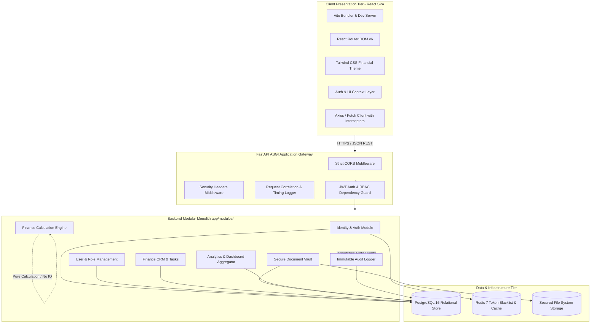

# System Architecture — FinanceFlow

**Document Version:** 1.0.0  
**Phase:** Phase 0 — Project Initialization  
**Status:** Approved Baseline  

---

## 1. Architectural Strategy: The Modular Monolith

FinanceFlow is architected as a **Modular Monolith**. This paradigm combines the operational simplicity, transactional consistency, and developer velocity of a single unified deployment with the strict domain boundaries and encapsulation typical of microservices.



---

## 2. Tier Boundaries & Responsibilities

### 2.1 Client Presentation Tier (Frontend)
- **Role:** Deliver a fast, responsive, and visually clear user experience for finance operators.
- **Tech Stack:** React 18+, JavaScript (strictly ES modules, no TypeScript), Vite, React Router v6, Tailwind CSS.
- **Core Principles:**
  - Zero raw business invariants or sensitive validation rules trusted solely on the client.
  - Centralized API communication with automatic request token injection and 401 refresh/redirect interceptors.
  - Clean separation between presentation components, stateful container pages, and service APIs.

### 2.2 Application Service Tier (Backend)
- **Role:** Single source of truth for business rules, calculations, data validation, and security enforcement.
- **Tech Stack:** Python 3.11+ / 3.14, FastAPI, Pydantic v2, SQLAlchemy 2.0 (Modern Declarative Mapping).
- **Core Principles:**
  - Controller-Service-Repository separation inside each module.
  - Pydantic models strictly validate all incoming payloads before reaching business logic.
  - SQLAlchemy 2.0 session lifecycle managed via FastAPI dependency injection (`yield session`), ensuring atomic transaction rollbacks on uncaught exceptions.

### 2.3 Data & Infrastructure Tier
- **PostgreSQL 16:** ACID-compliant relational persistence for customer records, users, audit trails, and document metadata.
- **Redis 7:** Ultra-low-latency in-memory store for revoked JWT token blacklists and active session tokens.
- **Secured Local / Volume File Storage:** Document files stored on dedicated volume mounts with non-guessable UUID filenames, verified via SHA-256 hashes.

---

## 3. Detailed Directory Structures

### 3.1 Backend Application Layout (`backend/`)

```
backend/
├── app/
│   ├── core/                      # Shared infrastructure & cross-cutting concerns
│   │   ├── config.py              # Pydantic BaseSettings loading from .env
│   │   ├── database.py            # SQLAlchemy engine, sessionmaker, Base class
│   │   ├── security.py            # Password hashing, JWT creation & verification
│   │   ├── exceptions.py          # Custom domain exceptions & HTTP handlers
│   │   ├── logging.py             # Structured JSON logging configuration
│   │   └── redis.py               # Redis connection pool & blacklist helpers
│   ├── modules/
│   │   ├── identity/              # Authentication & Token lifecycle
│   │   │   ├── router.py          # /api/v1/auth endpoints
│   │   │   ├── schemas.py         # Login, Token, Refresh DTOs
│   │   │   ├── service.py         # Authentication logic & token generation
│   │   │   └── dependencies.py    # get_current_user, get_current_active_user
│   │   ├── users/                 # Staff profiles & RBAC
│   │   │   ├── router.py          # /api/v1/users endpoints
│   │   │   ├── models.py          # User, Role, UserRole ORM models
│   │   │   ├── schemas.py         # User DTOs
│   │   │   └── service.py         # User administration logic
│   │   ├── crm/                   # Customer profiles, notes, tasks
│   │   │   ├── router.py          # /api/v1/crm endpoints
│   │   │   ├── models.py          # Customer, FinancialProfile, Note, Task models
│   │   │   ├── schemas.py         # Customer and Task DTOs
│   │   │   └── service.py         # CRM business operations
│   │   ├── finance/               # Financial Calculation Toolkit
│   │   │   ├── router.py          # /api/v1/calculator endpoints
│   │   │   ├── engine.py          # Pure Python Decimal calculation math
│   │   │   └── schemas.py         # EMI, Amortization, SIP DTOs
│   │   ├── documents/             # Secure Document Management
│   │   │   ├── router.py          # /api/v1/documents endpoints
│   │   │   ├── models.py          # Document, DocumentVersion models
│   │   │   ├── schemas.py         # Upload metadata & response DTOs
│   │   │   ├── storage.py         # File storage abstraction & validation
│   │   │   └── service.py         # Document lifecycle service
│   │   ├── analytics/             # Reporting & Dashboard metrics
│   │   │   ├── router.py          # /api/v1/dashboard endpoints
│   │   │   ├── schemas.py         # Metric DTOs
│   │   │   └── service.py         # SQL aggregation queries
│   │   └── audit/                 # Tamper-evident Audit Logging
│   │       ├── router.py          # /api/v1/audit endpoints
│   │       ├── models.py          # AuditLog ORM model
│   │       ├── schemas.py         # AuditLog DTOs
│   │       └── service.py         # Asynchronous audit event recorder
│   ├── main.py                    # FastAPI root application & router assembly
│   └── tests/                     # Automated test suites
│       ├── conftest.py            # Test database fixtures, client factories
│       ├── test_auth.py           # Identity & RBAC tests
│       ├── test_calculator.py     # EMI & SIP numerical precision tests
│       ├── test_crm.py            # Customer & task lifecycle tests
│       └── test_documents.py      # Upload validation & storage tests
├── alembic/                       # Migration scripts
│   ├── env.py                     # Alembic migration environment
│   └── versions/                  # Individual timestamped migrations
├── alembic.ini                    # Alembic configuration file
├── requirements.txt               # Pinned Python package dependencies
└── Dockerfile.backend             # Production container definition
```

### 3.2 Frontend Application Layout (`frontend/`)

```
frontend/
├── public/                        # Static brand assets and favicon
├── src/
│   ├── assets/                    # SVG icons, illustrations, logo
│   ├── components/                # Reusable UI component library
│   │   ├── common/                # Buttons, Inputs, Modals, Badges, Loaders
│   │   ├── layout/                # Sidebar, Navbar, PageHeader, AppShell
│   │   ├── feedback/              # Alert banners, Toast notifications
│   │   └── tables/                # Paginated data table with sorting/filtering
│   ├── context/                   # Global React state providers
│   │   ├── AuthContext.jsx        # User state, token refresh, login/logout
│   │   └── AlertContext.jsx       # Global toast notification dispatch
│   ├── hooks/                     # Custom reusable hooks
│   │   ├── useAuth.js             # Convenient hook for AuthContext
│   │   ├── useDebounce.js         # Input debounce for search fields
│   │   └── useCalculator.js       # Client-side preview computation
│   ├── pages/                     # Routed views
│   │   ├── auth/                  # LoginPage, ForgotPasswordPage
│   │   ├── dashboard/             # DashboardOverviewPage
│   │   ├── crm/                   # CustomerListPage, CustomerDetailPage, TaskBoard
│   │   ├── calculator/            # EMICalculatorPage, SIPCalculatorPage
│   │   ├── documents/             # DocumentVaultPage, UploadModal
│   │   └── audit/                 # AuditLogViewerPage
│   ├── services/                  # HTTP API services
│   │   ├── apiClient.js           # Axios instance with auth interceptors
│   │   ├── authService.js         # Login, refresh, logout requests
│   │   ├── crmService.js          # Customer & Task API calls
│   │   ├── calcService.js         # Financial calculator backend calls
│   │   └── docService.js          # Multi-part file upload & download
│   ├── utils/                     # Formatting and mathematical utilities
│   │   ├── currency.js            # Currency formatting (INR / USD)
│   │   ├── date.js                # Timestamp formatting (ISO to friendly)
│   │   └── validation.js          # Client-side form validation schemas
│   ├── App.jsx                    # Route definitions and protected route guards
│   ├── index.css                  # Tailwind directives and custom financial theme
│   └── main.jsx                   # React root bootstrap
├── index.html                     # HTML5 entrypoint with SEO meta tags
├── package.json                   # Pinned npm dependencies & scripts
├── tailwind.config.js             # Custom Tailwind color palette & typography
├── vite.config.js                 # Vite development & build config
└── Dockerfile.frontend            # Nginx production build container
```

---

## 4. Cross-Cutting Concerns

### 4.1 Request Correlation & Structured Logging
Every incoming HTTP request generates or propagates an `X-Request-ID` header. Structured JSON log records output the timestamp, request ID, user ID (if authenticated), endpoint route, HTTP status code, and latency in milliseconds.

### 4.2 Error Handling & Envelope Normalization
All API errors return a standard envelope structure:
```json
{
  "success": false,
  "error": {
    "code": "ENTITY_NOT_FOUND",
    "message": "Customer record with ID 'c8f7e2a1' was not found.",
    "details": null,
    "request_id": "req-98f3-a12b"
  }
}
```

### 4.3 Database Session & Transaction Lifecycle
The database session provider employs an explicit generator pattern:
```python
async def get_db_session() -> AsyncGenerator[AsyncSession, None]:
    async with AsyncSessionLocal() as session:
        try:
            yield session
            await session.commit()
        except Exception:
            await session.rollback()
            raise
        finally:
            await session.close()
```
This ensures zero transaction leaks or uncommitted dirty reads.
