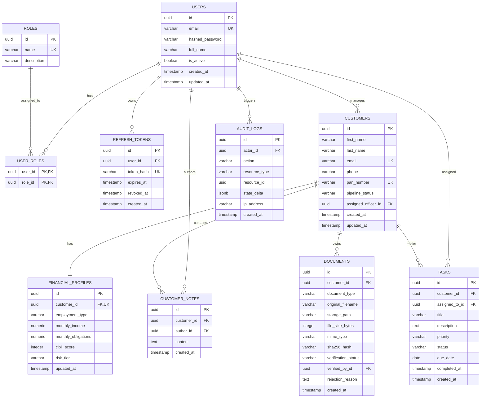

# Database Design & Schema Specification — FinanceFlow

**Document Version:** 1.0.0  
**Phase:** Phase 0 — Project Initialization  
**Status:** Approved Baseline  
**Database Engine:** PostgreSQL 16+  
**ORM / Migration Engine:** SQLAlchemy 2.0 (Async) + Alembic

---

## 1. Relational Design Strategy

FinanceFlow uses PostgreSQL as its primary relational store. The schema is organized into four core operational domains:
1. **Identity & Governance Domain:** Accounts, Roles, Role Mappings, Refresh Tokens.
2. **Finance CRM Domain:** Customers, Financial Profiles, Interaction Notes, SLA Tasks.
3. **Document Vault Domain:** Documents, Metadata, Checksums, Verification Logs.
4. **Compliance Domain:** Append-Only Immutable Audit Logs.

---

## 2. Entity-Relationship Diagram

---

## 3. Detailed Table Specifications

### 3.1 Domain 1: Identity & Governance

#### Table: `users`
| Column | Type | Constraints | Description |
| :--- | :--- | :--- | :--- |
| `id` | `UUID` | `PRIMARY KEY, DEFAULT gen_random_uuid()` | Unique user identifier |
| `email` | `VARCHAR(255)` | `NOT NULL, UNIQUE` | Staff email for authentication |
| `hashed_password` | `VARCHAR(255)` | `NOT NULL` | Argon2id / bcrypt hashed password string |
| `full_name` | `VARCHAR(150)` | `NOT NULL` | User full name |
| `is_active` | `BOOLEAN` | `NOT NULL, DEFAULT true` | Account active status flag |
| `created_at` | `TIMESTAMPTZ` | `NOT NULL, DEFAULT now()` | UTC creation timestamp |
| `updated_at` | `TIMESTAMPTZ` | `NOT NULL, DEFAULT now()` | UTC update timestamp |

*Indexes:*
- `ix_users_email` (B-Tree, Unique) on `email`
- `ix_users_is_active` (B-Tree) on `is_active`

#### Table: `roles`
| Column | Type | Constraints | Description |
| :--- | :--- | :--- | :--- |
| `id` | `UUID` | `PRIMARY KEY, DEFAULT gen_random_uuid()` | Role unique identifier |
| `name` | `VARCHAR(50)` | `NOT NULL, UNIQUE` | Role code (`ROLE_ADMIN`, `ROLE_MANAGER`, `ROLE_OFFICER`, `ROLE_AUDITOR`) |
| `description` | `VARCHAR(255)` | `NULL` | Human-readable explanation of permissions |

#### Table: `user_roles`
| Column | Type | Constraints | Description |
| :--- | :--- | :--- | :--- |
| `user_id` | `UUID` | `NOT NULL, FK -> users(id) ON DELETE CASCADE` | User foreign key |
| `role_id` | `UUID` | `NOT NULL, FK -> roles(id) ON DELETE CASCADE` | Role foreign key |
| *Composite PK* | `(user_id, role_id)` | `PRIMARY KEY` | Ensures 1:1 mapping per user-role pair |

#### Table: `refresh_tokens`
| Column | Type | Constraints | Description |
| :--- | :--- | :--- | :--- |
| `id` | `UUID` | `PRIMARY KEY, DEFAULT gen_random_uuid()` | Identifier |
| `user_id` | `UUID` | `NOT NULL, FK -> users(id) ON DELETE CASCADE` | Associated user |
| `token_hash` | `VARCHAR(64)` | `NOT NULL, UNIQUE` | SHA-256 hash of refresh token |
| `expires_at` | `TIMESTAMPTZ` | `NOT NULL` | Expiration timestamp |
| `revoked_at` | `TIMESTAMPTZ` | `NULL` | Timestamp when revoked |
| `created_at` | `TIMESTAMPTZ` | `NOT NULL, DEFAULT now()` | Creation timestamp |

*Indexes:*
- `ix_refresh_tokens_token_hash` (Unique) on `token_hash`
- `ix_refresh_tokens_user_id` on `user_id`

---

### 3.2 Domain 2: Finance CRM

#### Table: `customers`
| Column | Type | Constraints | Description |
| :--- | :--- | :--- | :--- |
| `id` | `UUID` | `PRIMARY KEY, DEFAULT gen_random_uuid()` | Customer unique identifier |
| `first_name` | `VARCHAR(100)` | `NOT NULL` | First name |
| `last_name` | `VARCHAR(100)` | `NOT NULL` | Last name |
| `email` | `VARCHAR(255)` | `NOT NULL, UNIQUE` | Primary contact email |
| `phone` | `VARCHAR(20)` | `NOT NULL` | Phone number (E.164 compliant) |
| `pan_number` | `VARCHAR(10)` | `NOT NULL, UNIQUE` | Permanent Account Number / Tax ID |
| `pipeline_status` | `VARCHAR(40)` | `NOT NULL, DEFAULT 'NEW_LEAD'` | Lifecycle status |
| `assigned_officer_id` | `UUID` | `NULL, FK -> users(id) ON DELETE SET NULL` | Assigned staff officer |
| `created_at` | `TIMESTAMPTZ` | `NOT NULL, DEFAULT now()` | Onboarding timestamp |
| `updated_at` | `TIMESTAMPTZ` | `NOT NULL, DEFAULT now()` | Last update timestamp |

*Indexes:*
- `ix_customers_pan_number` (Unique) on `pan_number`
- `ix_customers_email` (Unique) on `email`
- `ix_customers_pipeline_status` on `pipeline_status`
- `ix_customers_assigned_officer` on `assigned_officer_id`

#### Table: `financial_profiles`
| Column | Type | Constraints | Description |
| :--- | :--- | :--- | :--- |
| `id` | `UUID` | `PRIMARY KEY, DEFAULT gen_random_uuid()` | Profile identifier |
| `customer_id` | `UUID` | `NOT NULL, UNIQUE, FK -> customers(id) ON DELETE CASCADE` | 1-to-1 customer link |
| `employment_type` | `VARCHAR(50)` | `NOT NULL` | `SALARIED`, `SELF_EMPLOYED`, `BUSINESS`, `OTHER` |
| `monthly_income` | `NUMERIC(14,2)` | `NOT NULL, CHECK (monthly_income >= 0)` | Verified net monthly earnings |
| `monthly_obligations`| `NUMERIC(14,2)` | `NOT NULL, DEFAULT 0, CHECK (monthly_obligations >= 0)` | Existing debt obligations |
| `cibil_score` | `INTEGER` | `NULL, CHECK (cibil_score BETWEEN 300 AND 900)` | Bureau credit rating |
| `risk_tier` | `VARCHAR(20)` | `NOT NULL, DEFAULT 'MEDIUM'` | `LOW`, `MEDIUM`, `HIGH` |
| `updated_at` | `TIMESTAMPTZ` | `NOT NULL, DEFAULT now()` | Last recalculation timestamp |

#### Table: `customer_notes`
| Column | Type | Constraints | Description |
| :--- | :--- | :--- | :--- |
| `id` | `UUID` | `PRIMARY KEY, DEFAULT gen_random_uuid()` | Note identifier |
| `customer_id` | `UUID` | `NOT NULL, FK -> customers(id) ON DELETE CASCADE` | Related customer |
| `author_id` | `UUID` | `NOT NULL, FK -> users(id) ON DELETE RESTRICT` | Officer creating note |
| `content` | `TEXT` | `NOT NULL` | Free-text interaction note |
| `created_at` | `TIMESTAMPTZ` | `NOT NULL, DEFAULT now()` | Creation timestamp |

*Indexes:*
- `ix_customer_notes_customer_id` on `customer_id`

#### Table: `tasks`
| Column | Type | Constraints | Description |
| :--- | :--- | :--- | :--- |
| `id` | `UUID` | `PRIMARY KEY, DEFAULT gen_random_uuid()` | Task identifier |
| `customer_id` | `UUID` | `NOT NULL, FK -> customers(id) ON DELETE CASCADE` | Related customer |
| `assigned_to_id` | `UUID` | `NOT NULL, FK -> users(id) ON DELETE RESTRICT` | Assigned officer |
| `title` | `VARCHAR(200)` | `NOT NULL` | Task title |
| `description` | `TEXT` | `NULL` | Task context |
| `priority` | `VARCHAR(20)` | `NOT NULL, DEFAULT 'MEDIUM'` | `LOW`, `MEDIUM`, `HIGH`, `URGENT` |
| `status` | `VARCHAR(30)` | `NOT NULL, DEFAULT 'PENDING'` | `PENDING`, `IN_PROGRESS`, `COMPLETED`, `CANCELLED` |
| `due_date` | `DATE` | `NOT NULL` | SLA deadline date |
| `completed_at` | `TIMESTAMPTZ` | `NULL` | Completion timestamp |
| `created_at` | `TIMESTAMPTZ` | `NOT NULL, DEFAULT now()` | Creation timestamp |

*Indexes:*
- `ix_tasks_status` on `status`
- `ix_tasks_assigned_to_id` on `assigned_to_id`
- `ix_tasks_due_date` on `due_date`

---

### 3.3 Domain 3: Secure Document Vault

#### Table: `documents`
| Column | Type | Constraints | Description |
| :--- | :--- | :--- | :--- |
| `id` | `UUID` | `PRIMARY KEY, DEFAULT gen_random_uuid()` | Document identifier |
| `customer_id` | `UUID` | `NOT NULL, FK -> customers(id) ON DELETE CASCADE` | Document owner |
| `document_type` | `VARCHAR(50)` | `NOT NULL` | `PAN_CARD`, `AADHAAR_CARD`, `INCOME_PROOF`, `BANK_STATEMENT`, `PROPERTY_DEED` |
| `original_filename`| `VARCHAR(255)`| `NOT NULL` | Client file name |
| `storage_path` | `VARCHAR(500)` | `NOT NULL, UNIQUE` | Secured server path or storage URI |
| `file_size_bytes` | `INTEGER` | `NOT NULL, CHECK (file_size_bytes > 0)` | File payload size |
| `mime_type` | `VARCHAR(100)` | `NOT NULL` | Verified MIME type |
| `sha256_hash` | `VARCHAR(64)` | `NOT NULL` | SHA-256 integrity hash |
| `verification_status`| `VARCHAR(30)`| `NOT NULL, DEFAULT 'PENDING_REVIEW'` | `PENDING_REVIEW`, `VERIFIED`, `REJECTED` |
| `verified_by_id` | `UUID` | `NULL, FK -> users(id) ON DELETE SET NULL` | Reviewing officer / auditor |
| `rejection_reason` | `TEXT` | `NULL` | Explanation if rejected |
| `created_at` | `TIMESTAMPTZ` | `NOT NULL, DEFAULT now()` | Upload timestamp |

*Indexes:*
- `ix_documents_customer_id` on `customer_id`
- `ix_documents_verification_status` on `verification_status`
- `ix_documents_sha256_hash` on `sha256_hash`

---

### 3.4 Domain 4: Compliance & Audit

#### Table: `audit_logs`
| Column | Type | Constraints | Description |
| :--- | :--- | :--- | :--- |
| `id` | `UUID` | `PRIMARY KEY, DEFAULT gen_random_uuid()` | Audit event identifier |
| `actor_id` | `UUID` | `NULL, FK -> users(id) ON DELETE SET NULL` | Acting user ID (NULL for system) |
| `action` | `VARCHAR(50)` | `NOT NULL` | `CREATE`, `UPDATE`, `DELETE`, `LOGIN`, `LOGOUT`, `VERIFY` |
| `resource_type` | `VARCHAR(50)` | `NOT NULL` | Entity name (`CUSTOMER`, `DOCUMENT`, `USER`, `TASK`) |
| `resource_id` | `UUID` | `NULL` | Target record UUID |
| `state_delta` | `JSONB` | `NULL` | JSON structure recording changed fields |
| `ip_address` | `VARCHAR(45)` | `NULL` | IPv4 / IPv6 client address |
| `created_at` | `TIMESTAMPTZ` | `NOT NULL, DEFAULT now()` | Tamper-evident timestamp |

*Indexes:*
- `ix_audit_logs_actor_id` on `actor_id`
- `ix_audit_logs_resource` on `(resource_type, resource_id)`
- `ix_audit_logs_created_at` on `created_at`

---

## 4. Alembic Migration Protocol

To guarantee continuous schema reproducibility across development, CI, and deployment environments:
1. **Never call `Base.metadata.create_all()` in production code.**
2. All schema changes must be authored as versioned Alembic migration scripts in `backend/alembic/versions/`.
3. Every migration file must implement both `upgrade()` and `downgrade()` functions.
4. Downgrade procedures must be tested locally before submitting changes to ensure reversible migrations.
5. Migration naming convention: `YYYYMMDD_HHMM_<sequential_num>_<short_slug>.py` (e.g., `20261015_1000_001_initial_schema.py`).
