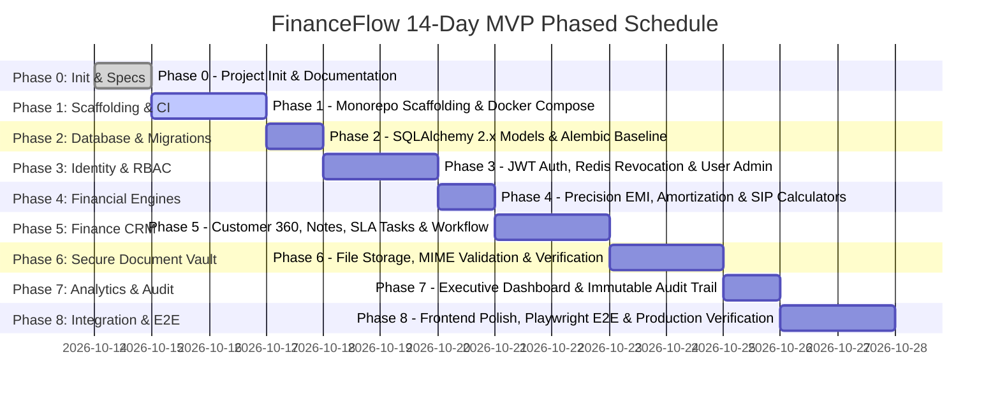

# Implementation Plan & Roadmap — FinanceFlow

**Document Version:** 1.0.0  
**Phase:** Phase 0 — Project Initialization  
**Status:** Approved Baseline  
**Timeline:** 14-Day Intensive MVP Schedule (Academic Capstone Field Project)

---

## 1. Executive Implementation Roadmap

The delivery roadmap is structured into 9 sequential, gated phases designed to ensure architectural stability, continuous testing, and zero technical debt.

---

## 2. Phase-by-Phase Breakdown & Acceptance Gates

### Phase 0: Project Initialization, Documentation & Standards (Day 1)
- **Scope:** Workspace inspection, documentation baseline under `docs/`, architecture design records, directory structure planning, and git baseline.
- **Completion Criteria:**
  - Workspace inspected and verified empty or existing code cataloged.
  - Complete documentation suite created under `docs/` with accurate cross-references.
  - Phased roadmap with completion criteria established.
  - Git repository initialized with comprehensive `.gitignore`.
  - Zero application code or mock databases created prematurely.

### Phase 1: Environment Scaffolding, Base Structure & CI Pipelines (Days 2–3)
- **Scope:** Initialize FastAPI backend skeleton, Vite + React frontend skeleton (JavaScript ES Modules, no TypeScript), Tailwind CSS styling tokens, Docker Compose definition, and GitHub Actions CI workflow.
- **Dependencies:** Phase 0 approval.
- **Deliverables:**
  - `backend/` with FastAPI app factory, configuration loader, and health check route (`/api/v1/health`).
  - `frontend/` with Vite, React Router, Tailwind configuration, and App shell.
  - `docker-compose.yml` defining `backend`, `frontend`, `postgres`, and `redis`.
  - `.github/workflows/ci.yml` running linting and baseline checks.
- **Completion Criteria:**
  - `npm run dev` and `uvicorn main:app --reload` start successfully without errors.
  - Frontend communicates with backend health check endpoint.
  - Initial tests pass in Pytest and Vitest.

### Phase 2: Database Schema Design, SQLAlchemy 2.x Models & Alembic (Day 4)
- **Scope:** Declarative SQLAlchemy 2.0 ORM models for all core domains (Users, Roles, Customers, Financial Profiles, Notes, Tasks, Documents, AuditLogs). Alembic baseline migration creation and verification.
- **Dependencies:** Phase 1.
- **Deliverables:**
  - `backend/app/db/` and module-level `models.py`.
  - Initial Alembic migration `versions/001_initial_schema.py`.
  - Database connection pool tests and rollback verification.
- **Completion Criteria:**
  - `alembic upgrade head` executes cleanly on PostgreSQL and generates all tables, indexes, and constraints.
  - `alembic downgrade base` cleanly removes all created tables without leaving orphaned types or constraints.

### Phase 3: Identity, Authentication & Role-Based Access Control (Days 5–6)
- **Scope:** User login, access/refresh token issuing, password hashing (Argon2id/bcrypt), Redis token revocation, route security dependencies, user management endpoints, and React AuthContext.
- **Dependencies:** Phase 2.
- **Deliverables:**
  - `/api/v1/auth/login`, `/refresh`, `/logout`, `/me`.
  - `/api/v1/users` CRUD endpoints for administrators.
  - React `LoginPage`, auth guards, and token refresh interceptors.
- **Completion Criteria:**
  - Automated Pytest suite verifying valid login, invalid password rejection, token expiry, and Redis logout revocation.
  - RBAC checks properly reject unauthorized requests with HTTP 403.

### Phase 4: Financial Calculations Engine (EMI, Amortization, SIP) (Day 7)
- **Scope:** Pure Python mathematical calculation engines using `Decimal` for high-precision EMI, loan amortization schedule generation, and SIP compound wealth with annual step-up. Interactive frontend calculation tools with dynamic charts/tables.
- **Dependencies:** Phase 3.
- **Deliverables:**
  - `/api/v1/calculator/emi`, `/amortization`, `/sip`.
  - `frontend/src/pages/calculator/` (interactive EMI slider, amortization table export, SIP growth chart).
- **Completion Criteria:**
  - 100% test coverage on calculation mathematical edge cases (zero interest, high tenure, leap year calculations).
  - Formula outputs mathematically verified against benchmark banking amortization schedules.

### Phase 5: Finance CRM (Customers, Profiles, Notes, Tasks) (Days 8–9)
- **Scope:** Comprehensive customer 360 management, financial profiling (income, obligations, credit rating), note timelines, SLA task tracking with priorities and statuses.
- **Dependencies:** Phase 4.
- **Deliverables:**
  - `/api/v1/crm/customers`, `/customers/{id}/notes`, `/customers/{id}/tasks`.
  - React Customer Directory with search, status filtering, customer creation wizard, and task kanban board.
- **Completion Criteria:**
  - End-to-end customer onboarding workflow functioning with database persistence.
  - Task status transitions (`PENDING`, `IN_PROGRESS`, `COMPLETED`, `OVERDUE`) operating reliably.

### Phase 6: Document Management Vault (Days 10–11)
- **Scope:** Multipart file uploads for KYC and loan collateral proofs. Server-side MIME validation, SHA-256 checksum generation, secure file storage abstraction, and document verification review workflows.
- **Dependencies:** Phase 5.
- **Deliverables:**
  - `/api/v1/documents/upload`, `/documents/{id}/download`, `/documents/{id}/verify`.
  - Frontend Document Vault component with drag-and-drop upload and status badges (`VERIFIED`, `REJECTED`, `PENDING`).
- **Completion Criteria:**
  - Files successfully stored outside web root with verified SHA-256 integrity.
  - Extension spoofing attempts (e.g., `.exe` renamed to `.pdf`) correctly rejected via magic byte inspection.

### Phase 7: Analytics, Executive Dashboard & Audit Logging (Day 12)
- **Scope:** Executive metrics aggregation, pipeline conversion funnel, portfolio risk distribution, and automated immutable audit event logging for all state mutations.
- **Dependencies:** Phase 6.
- **Deliverables:**
  - `/api/v1/dashboard/metrics`, `/api/v1/dashboard/portfolio-risk`.
  - `/api/v1/audit/logs` endpoint with filterable query parameters.
  - Frontend Executive Dashboard and Compliance Audit Viewer.
- **Completion Criteria:**
  - Real-time dashboard updates reflecting actual database customer records and loan inquiries.
  - State changes in CRM and Documents automatically populate the immutable audit log table.

### Phase 8: Integration Polish, Playwright E2E & Production Verification (Days 13–14)
- **Scope:** UI/UX styling polish with Tailwind CSS, error boundary integration, end-to-end testing with Playwright, final documentation alignment, and deployment verification.
- **Dependencies:** Phase 7.
- **Deliverables:**
  - Playwright automated browser test suite testing the full lifecycle: login -> customer creation -> financial calculation -> document upload -> audit log inspection.
  - Complete `docs/implementation/` audit records and updated `CHANGELOG.md`.
- **Completion Criteria:**
  - 100% of Playwright E2E and Pytest integration tests pass cleanly.
  - Production build (`npm run build`) generates clean bundle without warnings or errors.

---

## 3. Critical Path & Risk Management

| Risk | Impact | Likelihood | Mitigation Strategy |
| :--- | :--- | :--- | :--- |
| **Numeric Floating-Point Drift in Calculations** | High | Low | Enforce Python standard library `Decimal` in backend engine; avoid JavaScript floating arithmetic for ledger values. |
| **Docker Engine Absence on Host Machine** | Medium | High | Support standalone local development (`python -m uvicorn` + `npm run dev`) while container definitions remain production-ready for CI. |
| **Scope Creep from AI Document Features** | High | Medium | Strictly defer all OCR / ML pipelines to Post-MVP (Phase > 8). Core finance operations must achieve 100% stability first. |
| **Security Gaps in File Uploads** | High | Medium | Inspect file magic bytes using `python-magic` or header sniffing; store files under randomized UUID names without executing permissions. |
